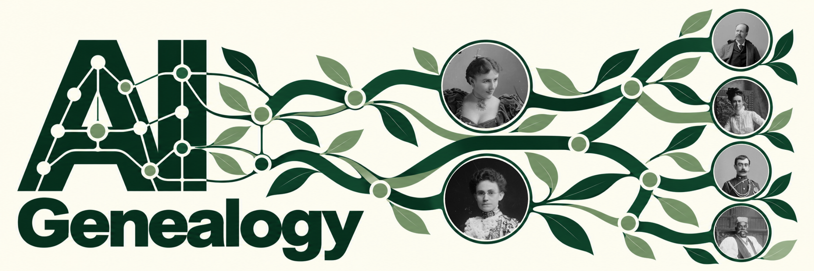

# AI Genealogy

AI-assisted family-history research, with a source for each claim and a clear trail to pick up next time.

This repository is being prepared. The [README layout study](docs/README.md) brings together the chosen artwork and sample copy, with three section-banner heights to compare. It is a design preview, not an installable release of the skill bundle.

## View the layout

Download this repository and open `docs/index.html` in a browser. The headline remains at 3:1; the section banners can be switched between 3:1, 5:1 and 6:1.

To edit the page, change `docs/index.template.html` and rebuild:

```sh
python3 scripts/build_preview.py
python3 scripts/build_preview.py --check
```

No dependencies are required beyond Python 3. The [artwork notes](docs/ARTWORK.md) record the archival portrait sources and explain which elements are generated illustrations.
