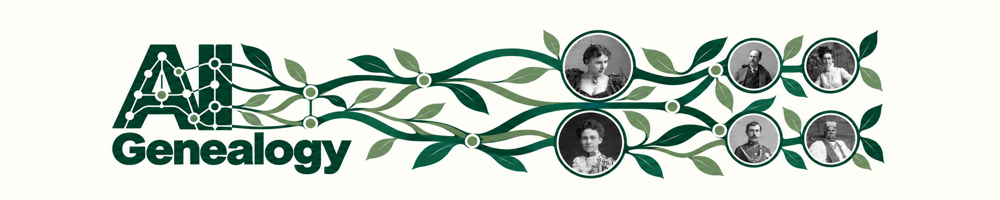
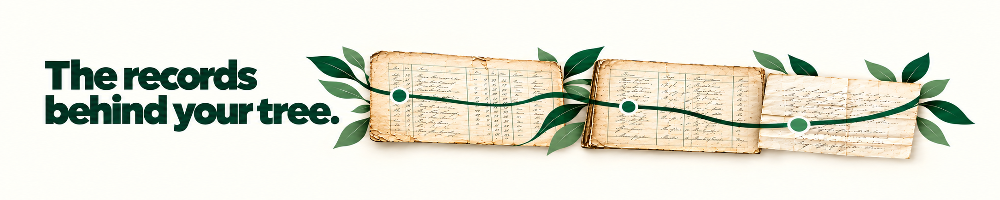
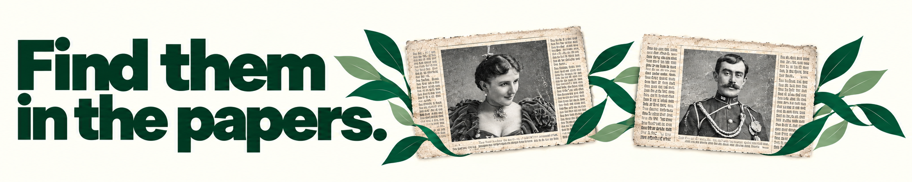
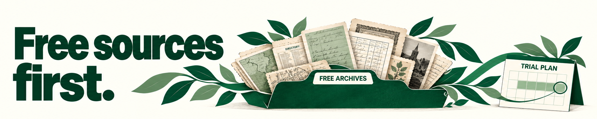

# Follow your family history. Keep the evidence.

Use an AI assistant to plan searches, read records and follow the questions your family tree leaves open. Keep the sources beside the findings, so you can check a conclusion and pick up the research another day.

[Get started](#start) · [Records](#records) · [Newspapers](#newspapers) · [Free sources and trials](#access)

## Start with one question

A name, a date and a place are enough to begin a search. You might want to identify someone in a census, explain a move between towns or find out whether two records describe the same person.

1. Bring the records you already have and say what you want to find out.
2. Ask your assistant to compare the possible matches and suggest the next search.
3. Save the sources, the unresolved questions and the candidates you ruled out.

> “These two census entries may describe the same person. Compare the ages, addresses and family members, then tell me what record would help us decide.”

A transcript helps you find a record. The original page can tell you more: a relationship column, a witness, a previous address or a note in the margin.

Keep what the document says separate from what you think it means. A useful research note should make it easy to see the evidence for a match, the reasons to doubt it and what to check next.

### Leave something you can return to

- The record, its reference and where you found it.
- The details that support the match, including anything that does not fit.
- The next question, even when the answer is still “we don’t know”.

Newspapers can add the everyday detail that a family tree misses. A wedding notice might name relatives, a local report might give an occupation, and an obituary might point you towards an earlier home.

Search a few spellings, initials and nearby places. Then read the page around a promising result. A familiar name or photograph is a lead to check against the rest of the evidence.

> “Look for this surname in the local paper around the marriage date. Try initials and spelling variations, and keep the date, page and title for anything useful.”

Start with the sources you can already use. Before paying for access, make a short list of the records you need and the questions they might answer.

| Access | A useful starting point |
| --- | --- |
| Free sources | Search indexes such as FreeBMD, FreeREG and FreeCEN. Coverage and access to original images vary. |
| Free trials | Prepare your searches first. Check which collections are included, the renewal terms and the cancellation date. |
| Paid records | Identify the exact record and what it could resolve before ordering a certificate or archive copy. |

An AI subscription does not include access to genealogy websites. Your assistant can help organise the search; you decide what to buy and what to add to your tree.

## Make the next session easier

Finish with the findings, the open questions and the next useful step. A family-history project can take years. It should not take hours to remember where you left it.

This is a design preview with sample README copy. Installation instructions and links to the research guides will be added when the package is published.

About the artwork and this preview

All four banners, including the headline, have been recomposed for a 5:1 format in the chosen green-and-ivory identity.

The family connections, documents and newspaper layouts are illustrative. The headline and newspaper portraits are generated treatments of references from the Library of Congress C. M. Bell collection, not unaltered scans or evidence of a family relationship. See the [artwork notes](docs/ARTWORK.md) for source information.

[Open the companion mock page](https://tjqscott.github.io/ai_genealogy/). The [preview guide](docs/README.md) explains how to edit and rebuild it.

